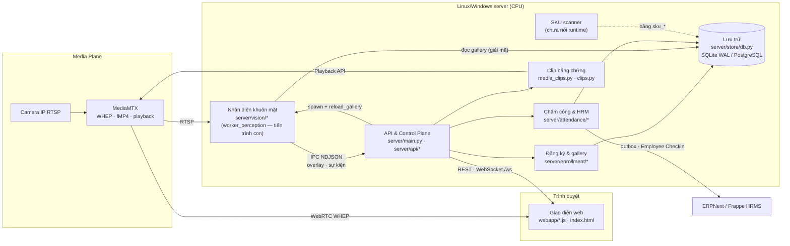
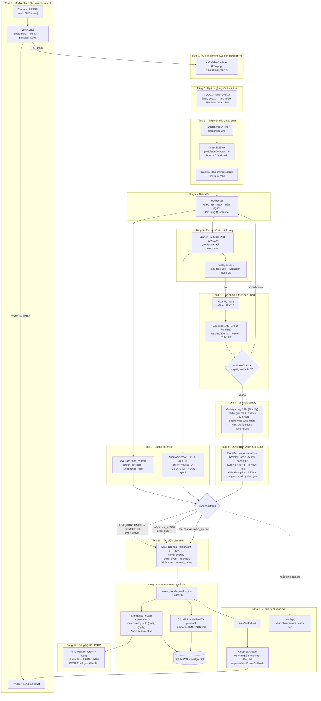
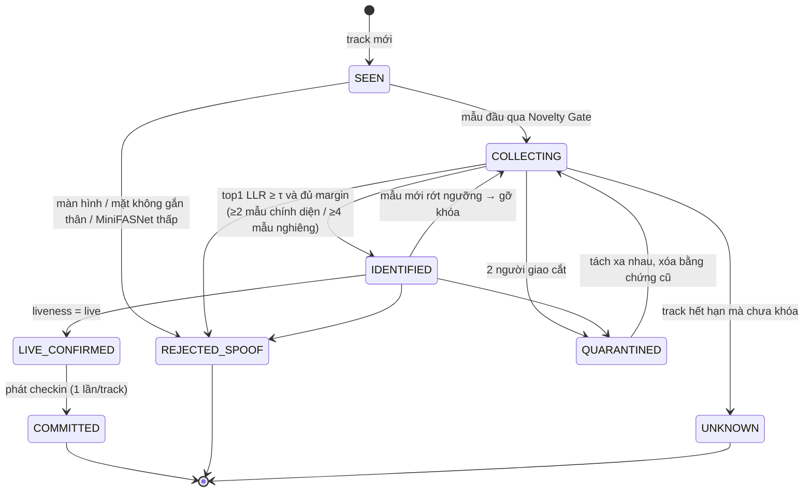
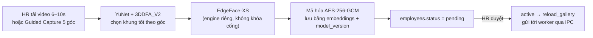

# Knowledge graph FaceGate v4 (sinh bởi /understand)

Nền tảng camera AI chạy CPU: nhận diện khuôn mặt nhân viên tại cổng để chấm công, chống giả mạo nhiều lớp, sổ cái chấm công bất biến, clip bằng chứng ký HMAC và đồng bộ HRM/ERPNext; kèm lõi quét SKU (chưa nối runtime).

- Cập nhật: 2026-11-18, commit `f0966a3`. Thay thế bản cũ mô tả cấu trúc `app/` (đã chuyển sang `server/` + `webapp/`).
- 78 file · 338 node (70 file, 44 class, 216 function, 6 document, 2 config) · 781 edge · 12 tầng · 14 bước tour
- Dữ liệu đầy đủ cho dashboard: [docs/knowledge-graph.json](knowledge-graph.json) (bản gốc ở `.ua/knowledge-graph.json`). Xem tương tác: `/understand-dashboard`.
- Không phân tích: `data/`, `.specify/`, `specs/`, file model `*.onnx`/`*.bin`. `deploy/` nằm trong `.gitignore` nên không có node riêng, nhưng vẫn được nhắc trong sơ đồ.

## Sơ đồ kiến trúc tổng thể

Phụ trợ: **Kiểm thử** (`server/tests/`, pytest), **Công cụ & đánh giá** (`server/scripts/`: tải model, benchmark, replay eval, thu thập K0), **Cấu hình & khởi chạy** (`config.yaml`, `setup.*`, `run.*`), **Tài liệu** (`README.md`, `docs/`).

## Luồng nhận diện khuôn mặt (từ camera đến ERP)

Luồng mặc định khi nguồn là camera RTSP/HTTP: `pipeline.isolated_worker` tự bật ([server/config.py](../server/config.py)). Khi đó việc nhận diện chạy trong **tiến trình con riêng** `server.vision.worker_perception`. Tiến trình chính FastAPI chỉ nhận kết quả qua IPC, ghi sổ và đẩy lên giao diện. Webcam USB và file video cục bộ dùng cùng lõi này nhưng chạy trong một luồng của `Pipeline` ([server/vision/pipeline.py](../server/vision/pipeline.py)).

### Sơ đồ các tầng

### Vòng đời trạng thái một track

### Bảng nhiệm vụ và công nghệ từng tầng

| Tầng | Nhiệm vụ | Công nghệ | Mã nguồn |
|---|---|---|---|
| 0. Media Plane | Kéo luồng RTSP **một lần duy nhất** từ camera, phát lại cho trình duyệt qua WebRTC WHEP, ghi fMP4 để cắt clip bằng chứng. Video hiển thị **không chờ AI**. | MediaMTX, RTSP/TCP, WebRTC WHEP, fMP4 | [deploy/mediamtx.yml](../deploy/mediamtx.yml), [server/scripts/run_mediamtx.sh](../server/scripts/run_mediamtx.sh) |
| 1. Giải mã khung | Đọc khung từ luồng main theo nhịp `detect_fps` (mặc định 6), đo `decode_ms`, gửi heartbeat 2 giây/lần. Chạy trong tiến trình con, được `main.py` tự khởi động lại sau 1 giây nếu chết. | OpenCV `VideoCapture` (FFmpeg backend), asyncio, subprocess | [worker_perception.py](../server/vision/worker_perception.py) `run_worker_loop` |
| 2. Ngữ cảnh | Tìm **người** (để cắt ROI và kiểm tra mặt có gắn thân) và **vật chứa màn hình** (điện thoại, laptop, TV) để phát hiện giả mạo bằng ảnh trên màn hình. | YOLOX-Nano COCO (Apache-2.0), ONNX Runtime, NMS NumPy | [context_detector.py](../server/vision/context_detector.py) |
| 3. Phát hiện mặt 2 giai đoạn | Cắt ROI đầu-vai 1:1 trên **khung gốc độ phân giải đầy đủ** để giữ mật độ pixel ở cự ly 2–3 m, chạy YuNet trên ROI. Nếu thiếu mặt thì quét bù toàn khung ở 1280px. Khử trùng bằng IoU, giữ tối đa 10 mặt lớn nhất. | YuNet 2023mar (`cv2.FaceDetectorYN`, Apache-2.0) | `detect_faces_two_stage_3mp` trong [worker_perception.py](../server/vision/worker_perception.py), [engines.py](../server/vision/engines.py) |
| 4. Theo dõi | Ghép mặt của khung mới vào track cũ theo IoU và hộp thân người, dự đoán vị trí theo vận tốc. Khi 2 người giao cắt thì đưa track vào **Crossing Quarantine** (xóa bằng chứng, chống gán nhầm danh tính). | IoU tracker tự viết, NumPy | [tracker.py](../server/vision/tracker.py) |
| 5. Tư thế & chất lượng | Ước lượng yaw/pitch/roll đến ±90°, phân nhóm `pose_group` (chính diện/nghiêng) có hysteresis. Chấm chất lượng: kích thước mặt tối thiểu, độ nét Laplacian trên vùng da nhìn thấy. Mặt không đạt **không được trích đặc trưng**. | 3DDFA_V2 MobileNet 120×120 (MIT, ONNX), OpenCV Laplacian | [pose3d.py](../server/vision/pose3d.py), [quality.py](../server/vision/quality.py) |
| 6. Căn chỉnh & đặc trưng | Căn mặt về 112×112 theo landmark và tư thế, trích vector 512 chiều theo lô (tối đa 10 mặt/lần). Nếu vector mới quá khác vector gộp của track (cosine < 0.25) thì **tách track** vì tracker đã nối nhầm sang người khác. | EdgeFace-XS γ0.6 (MIT), ONNX Runtime CPU (tùy chọn OpenVINO) | [engines.py](../server/vision/engines.py) `EdgeFaceEngine`, `process_frame` |
| 7. So khớp gallery | Tính cosine giữa vector mới và toàn bộ vector đã đăng ký (giải mã khi nạp), lấy điểm cao nhất của từng nhân viên, ưu tiên mẫu cùng `pose_group`. | NumPy (nhân ma trận), AES-256-GCM (`cryptography`) | [gallery.py](../server/enrollment/gallery.py), [security.py](../server/api/security.py) |
| 8. Quyết định Open-Set | Chỉ nhận mẫu mới khi đủ khác (≥ 250 ms hoặc lệch ≥ 8°). Quy cosine, góc nghiêng và chất lượng ra điểm LLR, cộng dồn theo từng ứng viên. Chỉ **khóa danh tính** khi top-1 ≥ τ và cách biệt với top-2 đủ lớn (biên tăng theo góc nghiêng). Không đủ thì giữ `Unknown`, **không đoán tên**. | Mô hình LLR logistic 4 tham số (NumPy) | [decision.py](../server/vision/decision.py) |
| 9. Chống giả mạo | Ba lớp: mặt nằm trong hộp điện thoại/màn hình (`screen_detected`); mặt không gắn với thân người liên tiếp 4 khung (`unattached_face`); điểm "người thật" từ MiniFASNet, chỉ đo khi mặt gần chính diện. | MiniFASNet V2 + V1SE (Apache-2.0, ONNX), luật hình học | [liveness.py](../server/vision/liveness.py), [context_detector.py](../server/vision/context_detector.py) |
| 10. IPC | Đưa kết quả từ worker sang tiến trình chính: `frame_overlay` (hộp vẽ mỗi chu kỳ), `track_event` (`checkin`, `spoof`, `appearance_closed`), `heartbeat`. Chiều ngược: lệnh `reload_gallery` sau khi đăng ký/duyệt nhân viên. Worker chết không làm sập web. | NDJSON qua Unix domain socket (Linux) hoặc TCP loopback | [ipc.py](../server/api/ipc.py) |
| 11. Control Plane & sổ cái | Ghi `events`, ghi bút toán `checkin_created` vào sổ cái **chỉ thêm, không sửa** với khóa chống trùng theo ngày, gắn cờ hậu kiểm cho lượt `profile_verified` sát ngưỡng / gần cảnh báo spoof / mẫu ngẫu nhiên 5%. Khi track đóng: tạo `appearance`, cắt clip từ MediaMTX playback, ký sidecar HMAC, giữ `legal_hold` với ca spoof. | FastAPI, SQLite WAL / PostgreSQL, ffmpeg, HMAC-SHA256 | [main.py](../server/main.py) `_handle_worker_ipc`, [ledger.py](../server/attendance/ledger.py), [media_clips.py](../server/vision/media_clips.py), [db.py](../server/store/db.py) |
| 12. Đồng bộ HRM/ERP | Hàng đợi outbox đẩy lượt chấm công sang HRM, thử lại có backoff, xử lý thu hồi. | `urllib` REST, ERPNext `Employee Checkin` | [hrm.py](../server/attendance/hrm.py), [shift.py](../server/attendance/shift.py) |
| 13. Hiển thị & phản hồi | Đẩy overlay và sự kiện qua WebSocket. Trình duyệt vẽ khung xanh/đỏ lên `<canvas>` đồng bộ với khung video WHEP, hiện lời chào. Loa camera Tapo nhắc "nhìn vào camera" hoặc cảnh báo giả mạo. | WebSocket, HTML5 Canvas, `requestVideoFrameCallback`, Tapo API | [whep_canvas.js](../webapp/whep_canvas.js), [app.js](../webapp/app.js), [audio_prompt.py](../server/vision/audio_prompt.py) |

### Luồng đăng ký khuôn mặt (nạp dữ liệu cho tầng 7)

Guided Capture dùng MediaPipe WASM trên trình duyệt ([guided_wasm.js](../webapp/guided_wasm.js)) để hướng dẫn quay đủ góc. Phía máy chủ xử lý ở [video.py](../server/enrollment/video.py) và [guided.py](../server/enrollment/guided.py).

## Các tầng kiến trúc và file

### Giao diện web
Dashboard HTML/CSS/JS thuần: xem video WHEP + overlay canvas, chấm công, lịch sử, đăng ký nhân viên, vẽ vùng.

- [webapp/app.js](../webapp/app.js) — Logic chính của dashboard web: kết nối WebSocket nhận sự kiện nhận diện, hiển thị trạng thái/feed chào mừng, âm báo và giọng nói, poll health, quy trình đăng ký 5 góc có hướng dẫn, quản lý nhân viên và nhật ký sự kiện.
- [webapp/attendance.js](../webapp/attendance.js) — Tab sổ cái chấm công: truy vấn bản ghi IN/OUT theo khoảng ngày, thu hồi bản ghi và xử lý hàng đợi kiểm duyệt (audit queue) cho HR.
- [webapp/guided_wasm.js](../webapp/guided_wasm.js) — Hướng dẫn góc đầu kiểu soi gương ngay trên trình duyệt bằng MediaPipe Face Landmarker WASM cục bộ, ước lượng yaw/pitch để nhắc người dùng khi đăng ký; ảnh mẫu cuối vẫn do server chụp.
- [webapp/history.js](../webapp/history.js) — Tab lịch sử clip bằng chứng: liệt kê clip theo bộ lọc, giữ/bỏ giữ clip, phát video kèm overlay khung khuôn mặt từ tệp sidecar.
- [webapp/index.html](../webapp/index.html) — Trang HTML dashboard FaceGate với các tab Live, Chấm công, Lịch sử, Đăng ký, Nhân viên, Sự kiện; nạp style.css và các script whep_canvas, guided_wasm, app, attendance, history, zone.
- [webapp/style.css](../webapp/style.css) — Stylesheet giao diện dashboard: bố cục tab, khung video/overlay, banner trạng thái, bảng dữ liệu và thẻ chào mừng.
- [webapp/whep_canvas.js](../webapp/whep_canvas.js) — Kết nối WebRTC WHEP tới MediaMTX và vẽ lớp phủ AI (bounding box theo vai trò) lên <canvas> đồng bộ bằng requestVideoFrameCallback; tự động fallback sang luồng MJPEG khi chưa bật MediaMTX.
- [webapp/zone.js](../webapp/zone.js) — Trình chỉnh vùng ROI (zone) nhận diện trên video: vẽ và chọn vùng bằng chuột rồi lưu cấu hình vùng qua API.

### Media Plane & clip bằng chứng
MediaMTX, cắt clip MP4 từ playback, ký sidecar HMAC, dọn clip theo retention.

- [server/vision/media_clips.py](../server/vision/media_clips.py) — Quản lý clip bằng chứng H.264 lấy từ MediaMTX Playback API: sidecar ký HMAC-SHA256, xác thực chống giả mạo, burn-in overlay bằng FFmpeg và dọn đĩa an toàn tôn trọng legal hold.
- [server/vision/clips.py](../server/vision/clips.py) — Ghi clip video bằng chứng cho mỗi track khuôn mặt với pre-roll/post-roll; mã hoá video chạy trong thread riêng qua hàng đợi để không làm chậm vòng nhận diện.
- [server/scripts/run_mediamtx.bat](../server/scripts/run_mediamtx.bat) — Script Windows khởi chạy MediaMTX với cấu hình deploy/mediamtx.yml, thiết lập thư mục ring buffer và biến môi trường camera mặc định (CAM_USER/CAM_PASS/CAM_IP).
- [server/scripts/run_mediamtx.sh](../server/scripts/run_mediamtx.sh) — Script Bash khởi chạy MediaMTX trên Linux với ring buffer RAM tmpfs (/dev/shm), biến môi trường camera mặc định và kiểm tra binary trong PATH.

### Nhận diện hàng hóa (SKU)
Quét QR/Barcode và khớp mẫu bao bì ORB/SIFT + RANSAC (chưa nối runtime).

- [server/vision/sku_scanner.py](../server/vision/sku_scanner.py) — Module nhận diện hàng hóa/SKU chạy CPU theo 2 tầng: ưu tiên giải mã QR/Barcode, fallback sang matching đặc trưng ORB/SIFT + RANSAC homography không cần train; trả kết quả dạng TrackedObject.

### Nhận diện khuôn mặt (Perception)
Worker tách tiến trình và pipeline cục bộ: YOLOX → YuNet → tracker → 3DDFA_V2 → EdgeFace → LLR → MiniFASNet, cùng camera và loa nhắc.

- [server/vision/camera.py](../server/vision/camera.py) — Đọc video từ webcam/RTSP/file trong thread riêng, chỉ giữ frame mới nhất để tránh trễ dồn; có tiện ích nhận diện loại nguồn và phát hiện frame đen.
- [server/vision/draw.py](../server/vision/draw.py) — Vẽ khung và nhãn tiếng Việt lên frame bằng Pillow, tự fallback bỏ dấu khi không có font hỗ trợ.
- [server/vision/context_detector.py](../server/vision/context_detector.py) — Phát hiện ngữ cảnh cơ thể và vật chứa giả mạo (điện thoại, màn hình, ảnh) bằng YOLOX-Nano ONNX, áp dụng quy tắc Viewport-Aware để đánh giá khuôn mặt có hợp lệ hay nghi spoof.
- [server/vision/decision.py](../server/vision/decision.py) — Máy trạng thái quyết định danh tính liên tục theo track: tích luỹ bằng chứng LLR 4 tham số, novelty gate, quarantine, áp liveness và chốt commit theo Nguyên tắc I Constitution.
- [server/vision/engines.py](../server/vision/engines.py) — Các face engine detect + embed với interface chung: OpenCV (YuNet+SFace), ONNX (SCRFD+ArcFace) và EdgeFace, kèm hàm căn chỉnh khuôn mặt theo landmark 5 điểm/pose và factory create_engine.
- [server/vision/pose3d.py](../server/vision/pose3d.py) — Ước lượng tư thế đầu 3D (yaw/pitch/roll) và 68 landmark 3D tới ±90 độ bằng 3DDFA_V2 ONNX, có fallback từ 5 điểm và phân nhóm pose.
- [server/vision/tracker.py](../server/vision/tracker.py) — IoU tracker nhẹ cho vài khuôn mặt tại cổng: gom embedding khung tốt theo track, dự đoán bbox, phát hiện nhảy người, cách ly khi cắt nhau và hỗ trợ split/absorb track.
- [server/vision/worker_perception.py](../server/vision/worker_perception.py) — Tiến trình Perception độc lập: đọc camera, phát hiện 2 giai đoạn trên ROI đầu-vai 1:1 khung 3MP, chạy tracker/pose/quality/liveness/ngữ cảnh/quyết định LLR và gửi TrackedObject qua IPC, chỉ hoạt động trong khung giờ ca.
- [server/vision/audio_prompt.py](../server/vision/audio_prompt.py) — Phát chuông/âm báo trên loa camera Tapo (Talk Stream port 8800 G.711 A-law MPEG-TS, manual alarm, playAlarm, custom audio qua pytapo) chạy trên luồng nền có backoff, kèm fallback Web Audio và bộ nhắc nhân viên nhìn…
- [server/vision/liveness.py](../server/vision/liveness.py) — Chống giả mạo thụ động (ảnh in, màn hình) bằng ensemble 2 model ONNX MiniFASNet V2/V1SE, trung bình softmax để trả xác suất người thật.
- [server/vision/pipeline.py](../server/vision/pipeline.py) — Vòng xử lý chính của FaceGate: detect -> track -> quality -> embed -> match -> liveness -> rule -> event, kèm phát hiện chuyển động để ngủ/thức, ghi clip và ghi sổ cái chấm công.
- [server/vision/quality.py](../server/vision/quality.py) — Đánh giá chất lượng khuôn mặt bằng heuristic không cần model: kích thước, độ nét, độ sáng, ước lượng yaw/pitch/roll từ 5 landmark và nhóm tư thế.
- [server/vision/__init__.py](../server/vision/__init__.py) — Tệp đánh dấu package rỗng cho gói `server.vision` (pipeline phát hiện, nhúng khuôn mặt, tracking).

### Đăng ký & gallery
Đăng ký bằng video / guided 5 góc, gallery embedding trong RAM.

- [server/enrollment/gallery.py](../server/enrollment/gallery.py) — Gallery embedding khuôn mặt nhân viên lưu trong RAM, thread-safe, thực hiện so khớp open-set dùng ngưỡng cosine và margin top-2 để trả về kết quả Match.
- [server/enrollment/__init__.py](../server/enrollment/__init__.py) — File khởi tạo package enrollment (rỗng), đánh dấu thư mục là Python package chứa luồng đăng ký khuôn mặt bằng video và có hướng dẫn.
- [server/enrollment/guided.py](../server/enrollment/guided.py) — Luồng đăng ký khuôn mặt có hướng dẫn kiểu app ngân hàng: dẫn người dùng qua 5 (hoặc 7) góc chữ thập cố định, chỉ chuyển bước khi đạt đúng góc so với tư thế nhìn thẳng của chính họ, rồi lưu embedding vào gallery.
- [server/enrollment/video.py](../server/enrollment/video.py) — Đăng ký khuôn mặt từ video ngắn: đọc frame, phân loại theo góc nhìn (pose bin), chọn 8-15 frame chất lượng tốt, loại outlier rồi lưu embedding vào DB; kèm backfill embedding cũ khi đổi model.

### Chấm công & HRM
Sổ cái chấm công bất biến, ca làm & đi muộn, outbox đồng bộ HRM/ERPNext.

- [server/attendance/hrm.py](../server/attendance/hrm.py) — Adapter đẩy sự kiện chấm công sang HRM qua outbox có retry: MockHRM ghi file JSONL và ERPNextHRM gọi API Employee Checkin của ERPNext/Frappe, điều phối bởi HRMWorker chạy nền.
- [server/attendance/ledger.py](../server/attendance/ledger.py) — Sổ cái chấm công bất biến append-only (attendance_ledger) và quy trình hậu kiểm ngoại lệ (audit-by-exception): ghi check-in tự động/thủ công, thu hồi, giữ clip, giải quyết hàng đợi audit và suy ra check-in hiệu lực.
- [server/attendance/shift.py](../server/attendance/shift.py) — Logic ca làm việc: định nghĩa Shift từ config, tính phút đi muộn, lời chào, và tổng hợp bảng công theo ngày (có mặt/muộn/vắng) cùng thống kê hôm nay.
- [server/attendance/__init__.py](../server/attendance/__init__.py) — Tệp đánh dấu package rỗng cho gói `server.attendance` (tính ca, đi muộn, outbox HRM).

### Lưu trữ
SQLite WAL / PostgreSQL, migration schema, mã hóa embedding.

- [server/store/db.py](../server/store/db.py) — Tầng lưu trữ SQLite (tùy chọn PostgreSQL) với schema nhân viên, embedding, sự kiện, appearances, sổ cái chấm công bất biến, audit log và bảng SKU; cung cấp lớp DB với migration và toàn bộ truy vấn CRUD.
- [server/store/__init__.py](../server/store/__init__.py) — Tệp đánh dấu package rỗng cho gói `server.store` (lưu trữ SQLite và migration).

### Kiểm thử
Bộ pytest cho độ chính xác, LLR, quarantine, ledger, IPC, media, SKU.

- [server/tests/test_api_v4_integration.py](../server/tests/test_api_v4_integration.py) — Test tích hợp API v4: dựng ctx giả lập rồi kiểm tra health, chấm công thủ công, thu hồi, legal hold, burn-in và phân quyền RBAC qua TestClient.
- [server/tests/test_camera.py](../server/tests/test_camera.py) — Unit test cho nhận diện nguồn webcam/file, ưu tiên backend V4L2 trên Linux và vẽ overlay chữ tiếng Việt.
- [server/tests/test_ledger_and_hold.py](../server/tests/test_ledger_and_hold.py) — Test sổ cái append-only, suy ra bảng công, đồng bộ 2 chiều ERPNext, hậu kiểm ngoại lệ với legal hold bảo vệ đĩa, và mã hóa AES-256-GCM cùng token RBAC.
- [server/tests/test_media_plane_clips.py](../server/tests/test_media_plane_clips.py) — Test media plane: cấu hình MediaMTX bỏ audio và dùng tmpfs, phát hiện giả mạo sidecar HMAC khi lấy clip playback và xuất burn-in.
- [server/tests/test_accuracy_v4_1.py](../server/tests/test_accuracy_v4_1.py) — Bộ test pytest độ chính xác v4.1 bao phủ căn chỉnh theo pose, tách track khi nhảy người, phát hiện 2 giai đoạn trên ROI 3MP, liveness/quality và các bản sửa sau code review.
- [server/tests/test_crossing_quarantine.py](../server/tests/test_crossing_quarantine.py) — Test cách ly khi hai track cắt nhau (crossing quarantine) để tránh thừa kế danh tính, cùng kiểm tra cắt viewport, ROI đầu-vai 1:1 trên khung 3MP và lịch chạy theo ca.
- [server/tests/test_decision_llr.py](../server/tests/test_decision_llr.py) — Test đơn vị cho bộ quyết định LLR: novelty gate khử tương quan khung tĩnh, LLR liên tục quanh 40 độ yaw cùng margin theo Constitution, và ràng buộc độ dốc cosine dương khi fit.
- [server/tests/test_audio_prompt.py](../server/tests/test_audio_prompt.py) — Bộ test pytest cho module âm báo: logic nhắc 'nhìn vào camera', notifier Tapo (manual alarm, custom audio, fallback web, backoff), API chime, tổng hợp chuông A-law port 8800 và chuyển WAV tiếng Việt.
- [server/tests/test_k0_collection_toolkit.py](../server/tests/test_k0_collection_toolkit.py) — Test pytest cho bộ công cụ thu thập K0: mở rộng/resume kế hoạch phiên, replay có trạng thái theo track với nhóm pose và hiệu chỉnh, và ghi bundle end-to-end trên file MP4.
- [server/tests/test_code_review_fixes.py](../server/tests/test_code_review_fixes.py) — Bộ test hồi quy cho các lỗi code review CR1-CR10: deadlock backfill, đẩy HRM đúng một lần, thu hồi check-in, mã hoá embedding fail-closed, giữ clip bằng chứng và chế độ isolated worker.
- [server/tests/test_guided.py](../server/tests/test_guided.py) — Kiểm thử luồng đăng ký có hướng dẫn bằng camera và engine giả: kiểm tra 5 bước chữ thập, điều kiện đạt góc, chặn khi có hai khuôn mặt, huỷ phiên và chế độ 7 góc/supplement.
- [server/tests/test_foundation_v4.py](../server/tests/test_foundation_v4.py) — Bộ test nền tảng v4 kiểm tra default/clamping của config, validate TrackedObject và IPC NDJSON, migration DB cùng tính idempotent của ledger, và đánh giá replay (Wilson CI, ISO 30107).
- [server/tests/test_ipc_fault_isolation.py](../server/tests/test_ipc_fault_isolation.py) — Test cách ly lỗi: mô phỏng tiến trình perception con gửi heartbeat qua IPC rồi bị SIGKILL, xác nhận control plane (IPCServer) không bị crash.
- [server/tests/test_sku_scanner.py](../server/tests/test_sku_scanner.py) — Bộ test cho SKU scanner: CRUD SKU trong DB, cảnh báo template ít texture, nhận diện tầng 1 QR/EAN-13, tầng 2 ORB/SIFT + RANSAC dưới biến dạng phối cảnh và cổng hình học tứ giác chiếu.

### Công cụ & đánh giá
Tải model, benchmark, replay eval, thu thập dữ liệu thực địa K0.

- [server/scripts/benchmark.py](../server/scripts/benchmark.py) — Script đo hiệu năng các backend nhận diện (detect/embed, pose 3D, quality) trên video 3MP@15fps và bài test ngân sách 10 khuôn mặt đồng thời (K0/K4 - T029).
- [server/scripts/replay_eval.py](../server/scripts/replay_eval.py) — Công cụ replay ngoại tuyến và đánh giá định lượng K0: replay stateful theo track, tính FAR impostor với Wilson CI 95%, calibrate LLR 4 tham số và xuất báo cáo Markdown K0.5.
- [server/scripts/k0_field_runner.py](../server/scripts/k0_field_runner.py) — CLI điều phối ca quay thực địa Pha K0 tại cổng: mở rộng kế hoạch phiên từ YAML, preflight check (ffmpeg, GOP, không audio), chạy từng phiên có resume và cuối ca tự động chạy replay_eval xuất báo cáo K0.
- [server/scripts/record_k0_bundle.py](../server/scripts/record_k0_bundle.py) — Thu thập gói dữ liệu thực địa K0 từ camera Tapo C310: ghi luồng gốc ra MP4, chạy detect/embed/liveness/quality/context theo khung hình, xuất manifest.json, observations.jsonl và crops để đánh giá offline.
- [server/scripts/tapo_audio_probe.py](../server/scripts/tapo_audio_probe.py) — CLI kiểm tra kết nối loa camera TP-Link Tapo, liệt kê kiểu chuông hỗ trợ và phát thử chuông/âm báo qua notifier của hệ thống.
- [server/scripts/download_models.py](../server/scripts/download_models.py) — Script CLI tải các model được phép thương mại theo server/models/manifest.json (YuNet, SFace, YOLOX-Nano, MiniFASNetV2/V1SE), kiểm tra SHA-256 đầy đủ và min_bytes, ghi file nguyên tử; --verify-only chỉ kiểm tra; --models-dir chọn thư mục đích (tự chép manifest nếu thiếu).

### API & Control Plane
FastAPI: lifespan, giám sát worker, nhận IPC, REST/WS/MJPEG, RBAC, cấu hình.

- [server/api/records.py](../server/api/records.py) — Router FastAPI cung cấp API bảng công (JSON/CSV), hàng đợi hậu kiểm, thu hồi/chấm công thủ công, danh sách nhân sự và lịch sử xuất hiện kèm clip bằng chứng (legal hold, burn-in, xuất ZIP).
- [server/api/security.py](../server/api/security.py) — Bảo mật vận hành: mã hóa dữ liệu sinh trắc học AES-256-GCM (BiometricCipher) và token RBAC ký HMAC cho 3 vai trò viewer/hr/admin, kèm dependency FastAPI kiểm tra quyền.
- [server/api/state.py](../server/api/state.py) — Trạng thái dùng chung giữa các router: Broadcaster đẩy message từ thread bất kỳ tới các client WebSocket và đối tượng Ctx chứa runtime state khởi tạo trong lifespan.
- [server/main.py](../server/main.py) — Điểm vào ứng dụng FastAPI FaceGate: lifespan khởi tạo DB, engine nhận diện, camera, gallery, HRM worker, IPC với perception worker; cung cấp stream MJPEG, WebSocket, API enroll, nhân viên, sự kiện, metrics, nguồn…
- [server/config.py](../server/config.py) — Nạp file cấu hình YAML của FaceGate và áp giá trị mặc định v4 (ngưỡng nhận diện, liveness, tracking, HRM, âm báo...) kèm kẹp giới hạn an toàn cho từng tham số.
- [server/api/ipc.py](../server/api/ipc.py) — Định nghĩa giao thức IPC NDJSON bất đồng bộ (IPCServer/IPCClient qua Unix socket hoặc TCP) giữa tiến trình perception worker và control plane, cùng thực thể TrackedObject tổng quát cho face/person/sku.
- [server/__init__.py](../server/__init__.py) — Tệp đánh dấu package Python rỗng cho gói `server` gốc của backend FastAPI.
- [server/api/__init__.py](../server/api/__init__.py) — Tệp đánh dấu package rỗng cho gói `server.api` chứa các route HTTP/WebSocket.

### Cấu hình & khởi chạy
config.yaml, phụ thuộc, script setup/run.

- [config.yaml](../config.yaml) — Cấu hình runtime trung tâm của FaceGate gồm camera, pipeline, ngưỡng chất lượng/nhận diện/quyết định, tracking, liveness chống giả mạo, ca chấm công, clip bằng chứng, chế độ nguồn, enrollment, loa cảnh báo Tapo, đồng…
- [pyproject.toml](../pyproject.toml) — Cấu hình pytest tối giản: đặt pythonpath là thư mục gốc và chỉ định server/tests làm thư mục test.
- [requirements.txt](../requirements.txt) — Danh sách phụ thuộc Python của backend: OpenCV (headless trên Linux), numpy, FastAPI/uvicorn, onnxruntime, pyyaml, pillow, cryptography; kèm gợi ý tùy chọn psycopg (PostgreSQL) và pytapo (loa Tapo).
- [run.bat](../run.bat) — Script khởi động trên Windows: kiểm tra .venv đã cài, mở trình duyệt tới http://127.0.0.1:8090 rồi chạy module server.main.
- [run.sh](../run.sh) — Script khởi động trên Linux: kiểm tra .venv, đọc host/port từ server.config để dựng URL, tự mở trình duyệt khi có màn hình (trừ khi NO_BROWSER=1), hỗ trợ cờ FACEGATE_ISOLATED_WORKER rồi exec server.main.
- [setup.bat](../setup.bat) — Script cài đặt trên Windows gồm 3 bước: tạo môi trường ảo .venv, cài thư viện từ requirements.txt và tải model ONNX bằng download_models.py.
- [setup.sh](../setup.sh) — Script cài đặt trên Linux: tạo .venv (ưu tiên uv, nếu không thì dò Python >= 3.10), cài requirements, tải model ONNX và cảnh báo quyền đọc /dev/video* cho webcam.

### Tài liệu
README, hướng dẫn, tài liệu triển khai ERP, mẫu PR.

- [AGENTS.md](../AGENTS.md) — Hướng dẫn dành cho AI agent mô tả cấu trúc thư mục server/ (api, vision, enrollment, attendance, store, models, scripts, tests) và webapp/, kèm quy tắc tạo Pull Request theo template.
- [README.md](../README.md) — Tài liệu tổng quan dự án FaceGate v4: giới thiệu hệ thống chấm công khuôn mặt tại cổng chạy CPU, trạng thái tính năng, kiến trúc 3 mặt phẳng, hướng dẫn chạy nhanh trên Linux/Windows và các quyết định cần PM chốt.
- [docs/GIOI_THIEU_DU_AN.html](../docs/GIOI_THIEU_DU_AN.html) — Trang HTML giới thiệu dự án FaceGate cho bên nghiệp vụ: tóm tắt, kiến trúc, công nghệ và 7 bài toán đã giải quyết (nhận diện đa góc ±90°, đăng ký 7 góc, sổ cái chấm công bất biến, chống giả mạo, Crossing Quarantine,…
- [docs/HUONG_DAN_KY_THUAT.html](../docs/HUONG_DAN_KY_THUAT.html) — Trang HTML hướng dẫn kỹ thuật cài đặt và vận hành FaceGate: yêu cầu, cài đặt một lần, chạy nhanh (webcam/file video) và chế độ máy chủ v4 đầy đủ (MediaMTX + worker cô lập + bảo mật), kịch bản demo, benchmark/thu thập…
- [docs/KNOWLEDGE_GRAPH.md](../docs/KNOWLEDGE_GRAPH.md) — Bản tóm tắt knowledge graph ĐÃ LỖI THỜI do /understand sinh ra trước đây, mô tả bố cục cũ app/ (app/main.py, app/pipeline.py, app/static/...) với 5 lớp kiến trúc và tour 12 bước; mã nguồn hiện đã chuyển sang server/…
- [docs/TAI_LIEU_TRIEN_KHAI_ERP.md](../docs/TAI_LIEU_TRIEN_KHAI_ERP.md) — Tài liệu chuẩn bị triển khai ERPNext và mở rộng nền tảng camera AI (HRM + sản xuất): phân tích khoảng trống GAP-01..05 (IN/OUT 2 cam cổng, đồng bộ erp_employee_id, SKU runtime, đa camera/zone, hardening RBAC), các…
- [.github/PULL_REQUEST_TEMPLATE.md](../.github/PULL_REQUEST_TEMPLATE.md) — Mẫu mô tả Pull Request của repo với các mục Summary, Ticket Link, Screenshots và Release Note bắt buộc (khối release-note).

## Tour tham khảo

1. **Tổng quan dự án** — FaceGate v4 nhận diện khuôn mặt nhân viên tại cổng để chấm công trên CPU, có chống giả mạo, sổ cái bất biến và đồng bộ HRM/ERPNext. Đọc README và config.yaml trước để nắm các tham số chính (backend edgeface, detect_fps, ngưỡng LLR).
2. **Điểm vào FastAPI & giám sát worker** — main.py dựng mọi thành phần trong lifespan, khởi tiến trình con worker_perception (tự khởi động lại khi chết) và nhận kết quả qua IPC trong _handle_worker_ipc.
3. **Media Plane: camera → MediaMTX → trình duyệt** — MediaMTX kéo RTSP một lần, phát WebRTC WHEP cho trình duyệt và ghi fMP4 để cắt clip; video hiển thị không chờ AI.
4. **Worker nhận diện: giải mã & phát hiện 2 giai đoạn** — worker_perception đọc khung theo detect_fps, YOLOX-Nano tìm người/màn hình, cắt ROI đầu-vai để YuNet tìm mặt trên khung gốc, quét bù toàn khung khi thiếu.
5. **Theo dõi, tư thế 3D và chất lượng** — IoUTracker giữ track và cách ly khi 2 người giao cắt; 3DDFA_V2 ước lượng yaw/pitch/roll; quality.assess loại mặt nhỏ/mờ trước khi trích đặc trưng.
6. **Đặc trưng EdgeFace & gallery** — EdgeFace-XS trích vector 512-d theo lô; gallery so cosine với embedding đã giải mã AES-256-GCM, ưu tiên cùng pose_group; split_cosine tách track nối nhầm.
7. **Quyết định Open-Set bằng LLR** — TrackDecisionAccumulator cộng dồn LLR qua nhiều mẫu khác nhau, chỉ khóa danh tính khi vượt τ và đủ cách biệt top-2; không đủ thì giữ Unknown.
8. **Chống giả mạo** — Ba lớp: mặt trong màn hình, mặt không gắn thân, và MiniFASNet đo khi mặt gần chính diện. Loa Tapo nhắc nhìn camera.
9. **IPC giữa worker và Control Plane** — NDJSON qua Unix socket/TCP loopback: frame_overlay, track_event, heartbeat; chiều ngược reload_gallery. Worker lỗi không làm sập web.
10. **Sổ cái chấm công, clip bằng chứng & HRM** — Checkin ghi vào attendance_ledger với idempotency theo ngày và hậu kiểm theo ngoại lệ; clip MP4 ký HMAC; HRMWorker đẩy Employee Checkin sang ERPNext.
11. **Đăng ký khuôn mặt** — Đăng ký bằng video ngắn hoặc Guided Capture 5 góc (MediaPipe WASM phía trình duyệt), chọn khung tốt, lưu pending chờ HR duyệt.
12. **Giao diện dashboard** — index.html nạp các tab: camera, chấm công, lịch sử clip, nhân viên, vùng phát hiện; dữ liệu đến qua REST và WebSocket.
13. **Pipeline cục bộ & module SKU** — pipeline.py chạy cùng lõi nhận diện trong 1 tiến trình cho webcam/file (có ngủ/đánh thức theo chuyển động); sku_scanner.py là lõi quét hàng hóa chưa nối runtime.
14. **Đánh giá & kế hoạch ERP** — benchmark/replay_eval đo hiệu năng và độ chính xác; tài liệu ERP mô tả lộ trình mở rộng HRM + Sản xuất.
